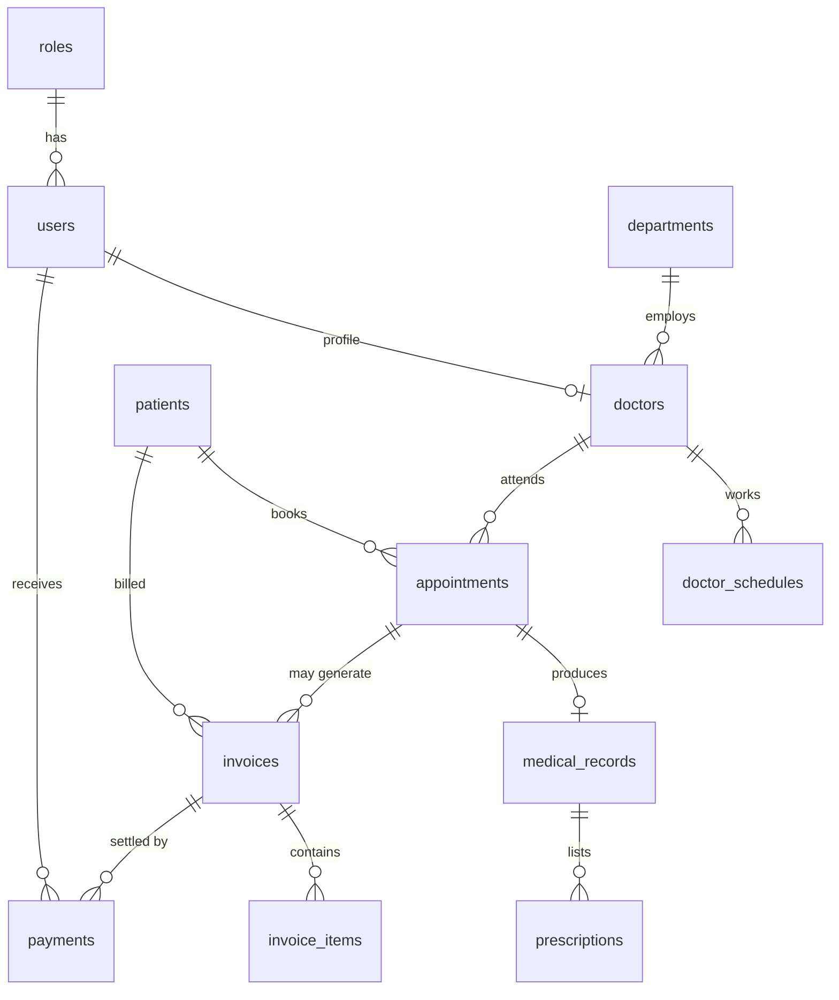

# MediCare HMS – System Design

## 1. Goals
Clinic/hospital management for **patient registration, doctor scheduling, appointment booking, consultations and billing**, with three roles (Admin, Doctor, Receptionist) and guaranteed no double-booking.

## 2. Architecture
Classic server-rendered 3-tier monolith.

```
Browser (HTML + CSS, Jinja2 templates)
   │  HTTP + session cookie (HttpOnly, SameSite=Lax) + CSRF token on every POST
Flask app  ── blueprints: auth · main · patients · appointments · clinical · billing · admin
   │            services.py  (slot generation + conflict detection)
   │            utils.py     (validation)   models.py (SQLAlchemy ORM)
MySQL 8 (InnoDB, FK constraints, CHECK + UNIQUE constraints)
```

| Layer | Module | Responsibility |
|---|---|---|
| Presentation | `templates/`, `static/style.css` | Role-aware navigation, forms, print-friendly invoices |
| Controllers | `auth, main, patients, appointments, clinical, billing, admin` | Routing, authorisation, input validation, flash messages |
| Domain service | `services.py` | Slot generation, conflict rules, locking |
| Persistence | `models.py` | 12 normalised tables |

## 3. Database (12 tables, 3NF)



Design decisions
* **Roles table + FK** rather than an enum: new roles need no schema change.
* **Doctor = user + profile** (`doctors.user_id` UNIQUE): one login system, clinical data separated from credentials.
* **Weekly availability** lives in `doctor_schedules` (weekday + time window); concrete slots are *derived*, not stored, so changing hours never requires data migration.
* **Money** is `DECIMAL(10,2)` everywhere; totals/balances are computed from items and payments (never stored), so they cannot drift. Only `invoices.status` is cached and recalculated after each change.
* **Referential integrity**: all relationships are FKs. Clinical/financial rows use RESTRICT (no deleting a patient or doctor with history – they are *deactivated*); children that are meaningless alone (items, prescriptions, schedules) CASCADE.
* **CHECK constraints** guard status values, `end > start`, positive amounts/quantities, weekday range.
* **Indexes** on `(doctor_id, start_at)`, `(patient_id, start_at)`, patient name and phone, and every FK.

DDL: `schema.sql` (generated from the models by `scripts/export_schema.py`).

## 4. Role-based access control

| Capability | Admin | Receptionist | Doctor |
|---|:-:|:-:|:-:|
| Manage users, departments, doctors, working hours | ✔ | | |
| Reports & revenue dashboard | ✔ | | |
| Register / edit patients | ✔ | ✔ | |
| Deactivate patients | ✔ | | |
| View patients | ✔ | ✔ (no clinical data) | ✔ |
| Book / reschedule appointments | ✔ | ✔ | |
| Cancel appointments | ✔ | ✔ | own only |
| Complete consultation, write record & prescription | ✔ | | own only |
| Read medical records | ✔ | | own patients |
| Create invoices, items, discounts, payments | ✔ | ✔ | |
| Void invoice | ✔ | | |

Enforcement: `@roles_required(...)` decorator on every route (server side), plus object-level checks (a doctor can only act on appointments/records that belong to them). The UI hides links the user cannot use, but hiding is never the control.

Session security: password hashes (PBKDF2 via Werkzeug), session fixation prevented by `session.clear()` on login, 8-hour lifetime, login lockout (5 failures → 5 min), logout is POST-only, open-redirect-safe `next`, CSRF token on all state-changing requests, inactive users rejected on every request.

## 5. Time-slot conflict detection

A booking `(doctor, patient, start)` is accepted only if, inside one transaction:

1. The doctor row is locked (`SELECT … FOR UPDATE`) – concurrent bookings for the same doctor serialise.
2. `start` is in the future and the doctor/patient are active.
3. `start` is exactly one of the generated slots of that day (inside a working window, aligned to `SLOT_MINUTES`).
4. **Doctor overlap:** no active appointment with `existing.start < new.end AND existing.end > new.start`.
5. **Patient overlap:** the same test for the patient (a person can't be in two rooms).
6. **DB backstop:** `appointments.slot_key = "<doctor>:<start>"` is `UNIQUE` while the appointment is scheduled/completed and `NULL` after cancel/no-show. Even a bypassed application check cannot create a duplicate; the resulting `IntegrityError` is turned into a friendly message.

Rescheduling reuses the same function and excludes the appointment itself from the overlap checks, so moving to an adjacent or the same slot works. Cancelling or marking no-show frees the slot immediately.

Guard rails around schedules: working windows may not overlap; a window containing an upcoming appointment cannot be deleted; a doctor with upcoming appointments cannot be deactivated; a patient with upcoming appointments cannot be deactivated.

## 6. Billing flow
`Invoice (unpaid) → add items / discount → payments → partial → paid`, or `void` (admin, only if nothing paid).
Invoices created from an appointment get the doctor's consultation fee automatically; one live invoice per appointment. Rules: payment ≤ balance, no negative/NaN/∞ amounts, discount ≤ subtotal, nothing may leave an invoice over-paid, void invoices are read-only.

## 7. Route map
| Area | Routes |
|---|---|
| Auth | `GET/POST /login`, `POST /logout` |
| Dashboard | `GET /` (role-specific) |
| Patients | `/patients/`, `/patients/new`, `/patients/<id>`, `/patients/<id>/edit`, `POST /patients/<id>/toggle` |
| Appointments | `/appointments/`, `/appointments/new`, `/appointments/<id>/reschedule`, `POST …/cancel │ no-show │ complete` |
| Clinical | `/appointments/<id>/record`, `/records/<id>` |
| Billing | `/billing/`, `/billing/new`, `/billing/<id>`, `POST …/items │ discount │ pay │ void` |
| Admin | `/admin/users…`, `/admin/departments`, `/doctors`, `/admin/doctors…`, `/admin/doctors/<id>/schedule`, `/admin/reports` |

## 8. Testing
`pytest` (52 tests, in-memory SQLite): authentication & lockout, a parametrised role × URL access matrix, CSRF, double-booking (doctor and patient), outside-hours / misaligned / weekend / past bookings, cancel-frees-slot, reschedule, DB unique backstop, cross-doctor access denial, consultation → completion, invoice lifecycle, overpayment and malformed amounts, void rules, patient validation and duplicate detection, schedule guards.

## 9. Known limits / next steps
* Login lockout counters are in-process memory – use Redis if running multiple workers.
* Patient/doctor pickers load up to 500 patients; swap for AJAX search at larger scale.
* Possible extensions: audit log table, email/SMS reminders, insurance claims, pharmacy/lab modules, REST API + JWT, Alembic migrations.
